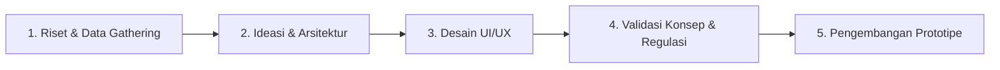

<div align="center">

  <p align="center">
    
    
  </p>

  <br />
  <br />

  # JagaJalan

  ### Cari penanggung jawab. Telusuri anggaran. Pantau tindak lanjut.
  *(Know the Authority. Trace the Budget. Track the Action.)*

  <p align="center">
    <strong>Platform Transparansi Kewenangan Jalan, Anggaran Proyek, dan Tindak Lanjut Pengaduan</strong>
  </p>

  <p align="center">
    Karya Inovasi Teknologi oleh <strong>COMEL Team</strong><br />
    Cabang Kompetisi <strong>Web In Action (WIA) — Multimedia In Action (MIA) 2026</strong><br />
    Diselenggarakan oleh <strong>KSM Multimedia UPN Veteran Jakarta</strong>
  </p>

  <p align="center">
    Tema Kompetisi: <em>Designing Digital Futures – Powering Public Transparency</em>
  </p>

  <p align="center">
    
    
    
    
    
  </p>

</div>

---

## 1. Latar Belakang dan Urgensi Masalah

Penanganan jalan rusak di Indonesia sering terhambat oleh tiga masalah tata kelola di luar faktor teknis keausan aspal: batas wewenang antardinas yang tumpang-tindih, data kontrak pemeliharaan LPSE yang terpisah dari peta jalan, serta lambatnya respons instansi daerah. Berdasarkan data resmi nasional:

1. **Tingginya Penundaan Tanggapan di Tingkat Daerah (Data Ombudsman RI 2025/2026)**
   Laporan Tahunan Ombudsman Republik Indonesia (dipublikasikan Februari 2026) mencatat **4.766 laporan masyarakat yang ditujukan kepada Pemerintah Daerah** (Provinsi, Kabupaten, dan Kota) sepanjang tahun 2025. Sektor perhubungan dan infrastruktur menyumbang **622 laporan**, dengan bentuk dugaan maladministrasi tertinggi berupa **Penundaan Berlarut (*Undue Delay*) sebesar 21,25%**. Angka ini menunjukkan masih lambatnya tindak lanjut birokrasi daerah atas keluhan warga.

2. **Kesenjangan Kemantapan Jalan Nasional vs Jalan Daerah**
   Data Satu Data Kementerian Pekerjaan Umum dan BPS SIRUSA menunjukkan ketimpangan kondisi fisik antara jalan nasional dan jalan daerah:
   - Jalan Nasional memiliki tingkat kemantapan di atas 90% karena didukung pembiayaan rutin APBN.
   - Sebaliknya, hampir 43% jalan kabupaten/kota mengalami rusak ringan hingga rusak berat akibat terbatasnya anggaran pemeliharaan APBD.
   - Ketimpangan ini mendorong diterbitkannya **Instruksi Presiden (Inpres) No. 3 Tahun 2023 tentang Percepatan Peningkatan Konektivitas Jalan Daerah (IJD)** dengan kucuran dana APBN sebesar **Rp 14,6 Triliun (Tahap I/2023)** dan **Rp 15,3 Triliun (Tahap II/2024)** untuk memperbaiki jalan daerah yang rusak parah.

3. **Kebingungan Warga atas Batas Wewenang Jalan (*Blame-Shifting*)**
   Pengguna jalan umumnya tidak mengetahui instansi mana yang bertanggung jawab atas ruas jalan yang mereka lewati setiap hari:
   - Jalan Nasional: tanggung jawab Kementerian Pekerjaan Umum melalui Balai Besar Pelaksanaan Jalan Nasional (BBPJN).
   - Jalan Provinsi: tanggung jawab Dinas Bina Marga Provinsi.
   - Jalan Kota/Kabupaten: tanggung jawab Dinas Pekerjaan Umum dan Penataan Ruang (PUPR) Kota/Kabupaten.
   Karena peta batas SK jalan jarang dibuka ke publik, aduan warga sering salah alamat atau dilempar dari satu dinas ke dinas lain.

4. **Terpisahnya Data Aduan Jalan dari Data Kontrak Lelang LPSE**
   Selama ini, kanal pengaduan warga dan portal pengadaan proyek (SiRUP/LPSE) berjalan sendiri-sendiri. Warga tidak tahu apakah jalan berlubang di depan rumahnya sebenarnya sudah memiliki kontrak pemeliharaan aktif, siapa kontraktor pemenang tendernya, berapa nilai kontraknya, atau kapan masa pemeliharaan proyek tersebut berakhir.

5. **Penerapan Arsitektur Dua Tingkat (*Two-Tier Data Architecture*)**
   JagaJalan menerapkan pendekatan data dua tingkat untuk menjaga keseimbangan antara gambaran makro dan penelusuran mikro:
   - *Tingkat Makro:* Dashboard nasional menyajikan data agregat kondisi dan kemantapan jalan dari 38 provinsi di Indonesia yang bersumber dari BPS (SIRUSA) dan publikasi resmi Kementerian Pekerjaan Umum, serta informasi anggaran yang relevan.
   - *Tingkat Mikro:* Penelusuran mendalam terhadap ruas jalan, lokasi kerusakan, batas kewenangan instansi, dokumen SK penetapan status jalan, paket pengadaan lelang LPSE, dan laporan masyarakat pada wilayah percontohan Sumatera Utara (Kota Medan dan sekitarnya) serta koridor arteri strategis nasional antarpulau.

---

## 2. Posisi Inovasi dan Pembeda Utama (Diferensiasi)

Berbeda dari kanal pelaporan satu arah seperti **Jalan Kita 2.0** (Kementerian PU) atau **SP4N-LAPOR!** (Kementerian PANRB), JagaJalan menggabungkan tiga informasi yang sebelumnya terpisah ke dalam satu layar: **peta SK wewenang jalan**, **dokumen kontrak lelang LPSE**, dan **hitung mundur batas waktu tanggapan 14 hari kerja**.

### Tabel Perbandingan Sistem:

| Indikator Perbandingan | Jalan Kita 2.0 (Kementerian PU) | SP4N-LAPOR! (Nasional) | JagaJalan (COMEL Team) |
| :--- | :--- | :--- | :--- |
| **Cakupan Kewenangan** | Terbatas pada Jalan Nasional | Kanal aduan tekstual umum instansi | Lintas Status Terpadu (Nasional, Provinsi, Kota/Kabupaten) dalam 1 Peta Geospasial |
| **Dasar Hukum Ruas** | Tidak menampilkan dokumen SK ruas | Tidak menampilkan dasar hukum | Menampilkan Nomor SK Menteri / Gubernur / Walikota untuk setiap segmen |
| **Penelusuran Anggaran APBD** | Tidak ada data anggaran proyek | Tidak ada keterkaitan anggaran | Terhubung langsung dengan Data Paket Pengadaan LPSE, Pagu, Nilai Kontrak, & Tingkat Keyakinan (*Match Confidence*) |
| **Jejak Tindak Lanjut Publik** | Tertutup untuk penanganan internal | Terbatas pada pesan balasan teks | Riwayat tahapan terbuka: Verifikasi, Penerusan Instansi, Batas Waktu Tanggapan, & Dokumentasi Fisik |
| **Mekanisme Akuntabilitas** | Tidak ada integrasi eskalasi formal | Menunggu alur birokrasi standar | Pemantauan Tanggapan (14 Hari Kerja) & Generator Draf Formal Laporan ke Ombudsman RI |
| **Peran Utama Sistem** | Kanal pelaporan jalan nasional | Kanal aspirasi pengaduan umum | Lapisan Transparansi Geospasial, Anggaran, & Kepatuhan Pelayanan Publik |

---

## 3. Tiga Pilar Inti Identitas JagaJalan

### 1. Kewenangan Lintas Status Jalan (*Know the Authority*)
Warga dan pemangku kepentingan dapat mengidentifikasi secara pasti siapa penyelenggara jalan yang bertanggung jawab atas suatu ruas:
- Mengunci instansi berwenang resmi (Kementerian PU / BBPJN, Dinas Bina Marga Provinsi, atau Dinas PUPR Kota/Kabupaten).
- Menampilkan dokumen regulasi resmi penetapan ruas jalan (Surat Keputusan Menteri PUPR atau Keputusan Kepala Daerah).
- Menghilangkan kebiasaan saling lempar tanggung jawab birokrasi di hadapan publik.

### 2. Anggaran dan Proyek yang Dapat Ditelusuri (*Trace the Budget*)
Setiap segmen ruas jalan disandingkan dengan informasi paket pengadaan pemeliharaan jalan berkala:
- Nama paket pekerjaan pengadaan dan tahun anggaran berjalan.
- Nilai pagu anggaran dan nilai kontrak hasil lelang tender LPSE.
- Identitas nama penyedia jasa / kontraktor pelaksana.
- Indikator tingkat keyakinan pencocokan data (*Match Confidence*: Terkonfirmasi, Pencocokan Parsial, Belum Ditemukan) beserta catatan verifikasinya.

### 3. Jejak Tindak Lanjut yang Transparan (*Track the Action*)
Masyarakat dapat memantau perjalanan laporan secara terbuka dan kronologis:
- Tanggal dan jam laporan diverifikasi.
- Instansi penerima disposisi laporan.
- Penghitungan batas waktu tanggapan (*Response SLA* 14 hari kerja).
- Dokumentasi foto bukti tindak lanjut fisik (*before-after documentation*) sebagai syarat penutupan tiket aduan.

---

## 4. Fitur Pendukung: AI Vision & Pemantauan SLA Ombudsman RI

### A. AI Vision Sebagai Pemeriksaan Awal Foto (Multimodal Initial Triage)
Modul Computer Vision berbasis model aktif Google Gemini 2.5 Flash berfungsi sebagai alat bantu pemeriksaan awal foto (*decision support tool*) dan pengelompokan laporan, bukan penentu resmi keabsahan laporan atau alat ukur laboratorium tanpa kalibrasi teknis:
- **Pemeriksaan Indikasi Kerusakan**: Mengidentifikasi tipe indikasi visual permukaan aspal (Lubang/Pothole, Penurunan Permukaan/Amblas, Retak Buaya/Alligator Cracking).
- **Penyaringan Relevansi Awal**: Membantu aparatur dinas menyaring foto yang tidak relevan dengan infrastruktur jalan atau mendeteksi kemiripan visual laporan pada titik lokasi yang berdekatan.
- **Estimasi Prioritas Awal (*Hazard Score* Skala 1-100)**: Menghasilkan rekomendasi skor prioritas awal berdasarkan tipe kerusakan tampak, perkiraan sebaran relatif terhadap jalur lalu lintas, dan potensi risiko bagi keselamatan pengguna jalan.

### B. Pemantauan Tanggapan Pelayanan Publik & Complaint Guidance Generator
- **Kesesuaian dengan Regulasi Pelayanan Publik**: Berdasarkan Pasal 44 ayat (2) UU No. 25 Tahun 2009 tentang Pelayanan Publik, penyelenggara pelayanan publik wajib memberikan tanggapan atas pengaduan paling lambat 14 (empat belas) hari kerja sejak pengaduan diterima secara resmi. JagaJalan menyajikan hitung mundur batas waktu ini sebagai acuan pemantauan publik setelah laporan diteruskan ke instansi terkait.
- **Complaint Guidance & Draft Generator**: Apabila laporan telah diteruskan kepada instansi penyelenggara namun melewati batas waktu 14 hari kerja tanpa tanggapan atau kepastian tindak lanjut (*indikasi penundaan berlarut / undue delay*), sistem menyediakan panduan pelaporan dan draf formal pengaduan ke Ombudsman RI. Draf ini merangkum data nomor tiket, tanggal penerusan, titik koordinat, foto dokumentasi, dan dasar regulasi yang dapat diunduh warga untuk diajukan secara mandiri melalui kanal resmi Ombudsman Republik Indonesia sesuai ketentuan yang berlaku.

### C. Dashboard Komparatif Regional 38 Provinsi
Menyajikan visualisasi data makro agregat 38 provinsi di Indonesia (bersumber dari publikasi resmi BPS dan kementerian terkait) yang dilengkapi filter wilayah pulau guna memberikan konteks perbandingan kebijakan publik dan kemantapan jalan secara nasional.

### D. Panel Detail Ruas (Live Inspector): Transparansi Proyek & Kepatuhan
Panel inspektur interaktif pada peta transparansi menyajikan informasi terpadu per segmen jalan:
- **Bukti Lapangan & Indikator AI**: Foto riil kondisi lapangan dengan indikasi tipe kerusakan dan rekomendasi prioritas pemeriksaan.
- **Kronologi Tanggapan Pelayanan**: Pelacakan kronologis tahapan (*Laporan Masuk ➔ Verifikasi Awal ➔ Disposisi Penyelenggara ➔ Pembaruan Penanganan Fisik*) berlandaskan transparansi pelayanan publik.
- **Informasi Paket Pengadaan**: Menampilkan nama paket pekerjaan, pagu anggaran, nilai kontrak SPK hasil lelang SiRUP/LPSE, nama penyedia jasa/kontraktor, dan persentase progres fisik percontohan.
- **Kepastian Yuridis Penyelenggara**: Penguncian instansi penanggung jawab resmi (Kementerian PU / Pemprov / Pemkab / Pemkot), pimpinan instansi penanggung jawab, serta nomor regulasi SK penetapan status ruas jalan.

---

## 5. Alur Perjalanan Pengguna (Multi-Role User Journey)

### 1. Peran Masyarakat / Pengguna Jalan
1. Mengakses peta interaktif untuk mengecek status jalan dan aduan aktif di rute aktivitas hariannya.
2. Memilih ruas untuk melihat instansi penanggung jawab resmi, dasar hukum SK, dan dokumen paket tender APBD terkait.
3. Mengunggah foto bukti kerusakan jalan yang diverifikasi otomatis oleh modul AI Vision.
4. Memperoleh kode tiket pelaporan untuk memantau kronologi tindak lanjut dan batas waktu tanggapan dinas.
5. Mengunduh draf resmi laporan ke Ombudsman RI jika instansi terlapor tidak memberikan tanggapan melampaui 14 hari kerja.

### 2. Peran Aparatur / Dinas Penyelenggara Jalan
1. Memantau antrean aduan yang telah terklasifikasi berdasarkan rekomendasi tingkat bahaya AI dan konfirmasi warga.
2. Menghindari aduan salah sasaran karena batas yurisdiksi jalan telah terkunci oleh data geospasial resmi.
3. Memperbarui status penanganan fisik secara transparan (Menunggu Verifikasi, Dalam Penanganan Fisik, Selesai).
4. Mengunggah foto dokumentasi perbaikan sebagai bukti pertanggungjawaban publik.

---

## 6. Desain Sistem, Identitas Visual, dan Pemisahan Warna

### A. Identitas Visual dan Filosofi Logo
Logo resmi JagaJalan tersimpan dalam direktori `public/logo/` dan dirancang khusus dalam format modular:
1. **`logo.png` (Simbol Ikon Utama)**:
   - **Siluet Jalan Beraspal ('J')**: Bentuk dasar huruf 'J' yang distilisasi menyerupai penampang lajur jalan raya beraspal, dilengkapi marka garis putih putus-putus (*road lane marking*) sebagai representasi fokus domain infrastruktur jalan.
   - **Pin Koordinat Geospasial**: Ornamen penanda lokasi di ujung atas huruf 'J' menyimbolkan presisi data geospasial (*geotagged accuracy*) dan penentuan batas kewenangan administratif per ruas jalan.
   - **Garis Luar Safety Orange**: Membingkai lambang dengan warna standar keselamatan kerja jalan raya untuk menegaskan proteksi, kewaspadaan, dan transparansi publik.
2. **`logo-name.png` (Tipografi Logotype / Wordmark)**:
   - Tipografi modern dan kokoh bertuliskan "JagaJalan" yang mengedepankan keterbacaan (*legibility*), kredibilitas institusional, dan ketegasan integritas publik. Ditampilkan berdampingan dengan `logo.png` pada Navbar, Footer, serta kop dokumen resmi.

### B. Sistem Warna Status Kewenangan Jalan
Untuk menghindari bias interpretasi data, JagaJalan memisahkan secara tegas antara sistem warna status kewenangan jalan dengan sistem warna status laporan pengaduan:
- **Biru (`#2563eb`)**: Jalan Nasional (Kementerian Pekerjaan Umum / BBPJN).
- **Ungu (`#7c3aed`)**: Jalan Provinsi (Dinas Bina Marga Provinsi).
- **Teal (`#0d9488`)**: Jalan Kota / Kabupaten (Dinas PUPR Daerah).

### C. Sistem Warna Status Pengaduan & Tindak Lanjut
- **Merah (`#dc2626`)**: Terlambat Menanggapi (>14 hari kerja tanpa tanggapan instansi).
- **Amber (`#d97706`)**: Menunggu Verifikasi atau Sedang Dalam Penanganan.
- **Hijau (`#16a34a`)**: Penanganan Fisik Selesai Diperbaiki.

### D. Warna Brand Utama & Tombol Aksi
- **Safety Orange (`#ea580c` / `#f97316`)**: Standar keselamatan jalan raya internasional yang digunakan untuk logo, tombol aksi utama (*+ Lapor Kerusakan*), dan highlight interaktif.

---

## 7. Desain Skema Basis Data (Database Schema)

Model data dirancang dengan normalisasi relasional yang memisahkan relasi paket pengadaan dengan ruas jalan melalui tabel penghubung (*junction table*), menyertakan metadata asal-usul data (*provenance*), serta memisahkan status pengerjaan fisik dari indikator keterlambatan tanggapan:

```
+-----------------------------------------------------------------------------------+
|                        DATABASE SCHEMA - JAGAJALAN PLATFORM                       |
+-----------------------------------------------------------------------------------+

 1. provinces_stat
    - id (PK)
    - nama_provinsi
    - kode_kemendagri
    - panjang_jalan_rusak_km
    - persentase_rusak
    - total_aduan_tercatat
    - aduan_overdue_tanggapan_count
    - alokasi_inpres_miliar_rp
    - data_year

 2. road_segments
    - id (PK)
    - nama_ruas
    - kode_ruas
    - kewenangan (NASIONAL | PROVINSI | KOTA_KAB)
    - instansi_penanggungjawab
    - dasar_hukum_sk
    - panjang_km
    - tipe_perkerasan
    - status_kondisi
    - geometry_coordinates (GeoJSON Polyline)
    - wilayah_administrasi
    - source_document_sk

 3. budget_packages
    - id (PK)
    - kode_paket_lpse
    - nama_paket_pekerjaan
    - tahun_anggaran
    - pagu_anggaran_rp
    - nilai_kontrak_rp
    - nama_kontraktor
    - sumber_dana (APBD_KOTA | APBD_PROV | APBN | INPRES)
    - status_tender
    - source_url
    - source_document
    - last_verified_at

 4. budget_package_segments (Tabel Penghubung Multi-Ruas)
    - id (PK)
    - budget_package_id (FK -> budget_packages.id)
    - road_segment_id (FK -> road_segments.id)
    - match_confidence (TERKONFIRMASI | PARSIAL | BELUM_DITEMUKAN)
    - match_reason_note

 5. road_reports
    - id (PK)
    - ticket_code (Contoh: JGJ-DPK-081)
    - road_segment_id (FK -> road_segments.id)
    - latitude
    - longitude
    - alamat_patokan
    - foto_bukti_url
    - ai_damage_category (Pothole | Subsidence | Alligator_Cracking)
    - ai_hazard_score (1-100)
    - ai_analysis_summary
    - reporter_masked_name (Privasi: Contoh 'D*** A.')
    - tanggal_lapor
    - target_response_deadline (Tanggal lapor + 14 hari kerja)
    - status_penanganan (MENUNGGU_VERIFIKASI | DALAM_PENGERJAAN | SELESAI)
    - is_response_overdue (Boolean: true jika >14 hari tanpa tanggapan)
    - days_overdue
    - support_upvotes_count

 6. report_updates (Audit Trail Penanganan)
    - id (PK)
    - report_id (FK -> road_reports.id)
    - tahapan (DIVERIFIKASI | DITERUSKAN_KE_DINAS | DALAM_PENGERJAAN | SELESAI)
    - catatan_tindakan
    - instansi_pelaksana
    - foto_bukti_penanganan_url
    - updated_at

 7. ombudsman_escalations
    - id (PK)
    - report_id (FK -> road_reports.id)
    - nomor_surat_draf
    - ringkasan_dugaan_maladministrasi
    - status_diserahkan (DRAF | DIUNDUH_WARGA | TERKIRIM)
    - created_at
```

---

## 8. Arsitektur Komponen dan Alur Interaksi Sistem

```
+-----------------------------------------------------------------------------------+
|               ARSITEKTUR MULTI-TIER & ALUR DATA SISTEM JAGAJALAN                  |
+-----------------------------------------------------------------------------------+

                            [ Pengguna: Publik & Dinas ]
                                         │
                                         ▼
+───────────────────────────────────────────────────────────────────────────────────+
|                           PRESENTATION LAYER (Next.js 16)                         |
|  - Layout: Navbar bersegmen, Footer minimalis regulasi & SLA                      |
|  - Modul Utama: HeroSection, BudgetDataExplorer, NationalRanking, OfficerPortal   |
|  - Engine Peta: Leaflet.js Geotagged polyline, dynamic pins & Live Ruas Inspector |
|  - Dialog Interaktif: ReportModal (AI Vision), OmbudsmanModal, RoadDetailModal    |
+────────────────────────────────────────┬──────────────────────────────────────────+
                                         │
                                         ▼
+───────────────────────────────────────────────────────────────────────────────────+
|                       APPLICATION & SERVICE LAYER (src/services/)                 |
|  - roadService: Filter yurisdiksi, komparasi kemantapan & konversi GeoJSON        |
|  - procurementService: Analisis audit deviasi, kalkulasi efisiensi HPS vs SPK     |
|  - aiService: Client bridge Google Gemini Vision AI road distress analysis        |
+────────────────────────────────────────┬──────────────────────────────────────────+
                                         │
                                         ▼
+───────────────────────────────────────────────────────────────────────────────────+
|                      REST API & SERVERLESS ROUTES (src/app/api/)                  |
|  - /api/roads: Standar RFC 7946 GeoJSON & metadata wewenang SIGI PU               |
|  - /api/procurement: Sinkronisasi paket lelang LPSE & SIRUP LKPP                  |
|  - /api/analyze-road: Endpoint serverless Google Gemini 2.5 Flash Vision          |
+────────────────────────────────────────┬──────────────────────────────────────────+
                                         │
                                         ▼
+───────────────────────────────────────────────────────────────────────────────────+
|                        DATA & EXTERNAL INTEGRATION LAYER                          |
|  - Sumber Data Resmi: Satu Data Kementerian PU, SIGI ASTv2, BPS SIRUSA, LPSE     |
|  - Preprocessing ETL: Python Data Engineering Pipeline (scripts/pipeline/)       |
|  - Penyimpanan Cloud Opsional: Firebase Firestore (Cloud Sync Laporan Masuk)     |
+───────────────────────────────────────────────────────────────────────────────────+
```

---

## 9. Struktur Organisasi Berkas Proyek

```text
jagajalan/
├── src/
│   ├── app/                     # Next.js App Router (Halaman & Desain Global)
│   │   ├── api/                 # Endpoints REST API Terpadu
│   │   │   ├── analyze-road/    # API Route: Google Gemini Vision AI Damage Inspector
│   │   │   ├── procurement/     # API Route: Penelusuran Paket Pengadaan LPSE / SIRUP
│   │   │   └── roads/           # API Route: Geodata Ruas Jalan (JSON & GeoJSON RFC 7946)
│   │   ├── portaldinas/         # Redirect routing untuk Portal Dinas
│   │   ├── globals.css          # Desain sistem & token tema Clean Light Dashboard
│   │   ├── layout.js            # Metadata root & pembungkus font interaktif
│   │   └── page.js              # Halaman utama orkestrator tab navigasi
│   ├── components/              # Komponen Antarmuka Terstruktur & Modular
│   │   ├── layout/              # Kerangka Tata Letak Global
│   │   │   ├── Navbar.jsx       # Header navigasi bersegmen & tombol lapor
│   │   │   └── Footer.jsx       # Footer minimalis, atribusi data resmi & SLA
│   │   ├── dashboard/           # Modul Ringkasan Analitik & Metrik Eksekutif
│   │   │   ├── HeroSection.jsx  # Metrik krisis, diferensiasi pilar, & feed aduan
│   │   │   ├── BudgetDataExplorer.jsx # Explorer transparansi pagu HPS vs SPK LPSE
│   │   │   ├── AnnualProgressChart.jsx # Tren historis penanganan jalan & IJD
│   │   │   ├── NationalRankingSection.jsx # Papan skor kemantapan 38 provinsi
│   │   │   ├── OmbudsmanMonitorSection.jsx # Pengawasan SLA tanggapan pelayanan publik
│   │   │   ├── CivicWorkflowSection.jsx # Alur partisipasi publik & dasar hukum
│   │   │   ├── LegalBasisSection.jsx # Landasan regulasi (UU Jalan, UU Pelayanan Publik)
│   │   │   ├── OfficerDashboard.jsx # Portal kerja verifikasi & bukti fisik dinas
│   │   │   └── OfficerLogin.jsx # Autentikasi sesi verifikator dinas
│   │   ├── map/                 # Mesin Pemetaan Geospasial
│   │   │   ├── MapExplorer.jsx  # Workspace peta, drawer ruas & audit LPSE
│   │   │   └── MapInner.jsx     # Layer OpenStreetMap, polyline ruas & custom pins
│   │   ├── modals/              # Dialog Interaktif & Eskalasi Hukum
│   │   │   ├── ReportModal.jsx  # Formulir geotag aduan & verifikasi Gemini Vision
│   │   │   ├── OmbudsmanModal.jsx # Generator draf laporan formal ke Ombudsman RI
│   │   │   └── RoadDetailModal.jsx # Detail komparasi audit fisik vs serapan dana
│   │   └── index.js             # Sentralisasi barrel export komponen
│   ├── services/                # Lapisan Layanan Bisnis & Abstraksi Data (Service Layer)
│   │   ├── roadService.js       # Layanan data geospasial & filter kewenangan jalan
│   │   ├── procurementService.js # Layanan kalkulasi efisiensi & anomali LPSE
│   │   ├── aiService.js         # Layanan koneksi Computer Vision Gemini AI
│   │   └── index.js             # Barrel export services
│   ├── data/                    # Sumber Basis Data & Agregasi Resmi
│   │   ├── roadsData.js         # Master data ruas jalan pilot & paket lelang
│   │   ├── reportsData.js       # Rekam aduan geotagged warga & status SLA
│   │   ├── provincesData.js     # Data makro 38 provinsi (BPS & SP4N-LAPOR!)
│   │   ├── officersData.js      # Profil verifikator kewenangan dinas terkait
│   │   ├── nationalHighwaysData.json # Geometri presisi jalan nasional Trans-Jawa/Sumatera
│   │   ├── provincialRoadsData.json # Geometri ruas jalan provinsi percontohan
│   │   ├── cityRegencyRoadsData.json # Geometri koridor jalan kab/kota strategis
│   │   └── index.js             # Sentralisasi barrel export basis data
│   └── lib/                     # Modul Utilitas & Konfigurasi Global
│       ├── constants.js         # Kodefikasi warna & standar limit SLA pelayanan publik
│       ├── utils.js             # Format mata uang Rupiah, kalkulasi SLA, & helper waktu
│       ├── firebase.js          # Inisialisasi Firebase Firestore (opsional cloud sync)
│       └── index.js             # Sentralisasi barrel export lib
├── scripts/                     # Otomasi & Pipeline Rekayasa Data (ETL)
│   ├── pipeline/                # Skrip pemrosesan geometri koordinat Open Data PU
│   │   ├── data/                # Arsip data mentah geospasial
│   │   └── README.md            # Dokumentasi metodologi pipeline data
│   └── seed-firestore-roads.mjs # Skrip seeding data jalan ke Firestore
├── public/                      # Aset statis & identitas visual
│   └── logo/                    # Varian logo resmi JagaJalan
├── .gitignore                   # Proteksi dependensi, cache, & env
├── jsconfig.json                # Konfigurasi path aliases (@components, @services, dll.)
├── LICENSE                      # Lisensi resmi MIT License
├── package.json                 # Dependensi Next.js 16, React 19, & Tailwind v4
└── README.md                    # Dokumentasi lengkap sistem & spesifikasi lomba
```

---

## 10. Spesifikasi Tumpukan Teknologi (Tech Stack)

Pengembangan platform JagaJalan mengombinasikan pustaka web modern, mesin geospasial, dan kecerdasan buatan multimodal:

### A. Kerangka Kerja Frontend & Antarmuka
- **Framework Utama**: Next.js 16 (App Router Architecture, React 19)
- **Pola Arsitektur**: *Layered Clean Architecture* (Presentation Layer ➔ Service Layer ➔ Serverless Route Handlers ➔ Data Repositories)
- **Styling Engine**: Tailwind CSS v4 (Palet warna identitas: *Warm Paper Cream*, *Deep Slate*, dan aksen *Safety Orange*)
- **Tipografi**: Plus Jakarta Sans (antarmuka publik) & Geist Mono (data teknis kode tiket, koordinat, dan anggaran)
- **Ikonografi**: Lucide React
- **Komponen Pemetaan Web**: React-Leaflet & Leaflet.js

### B. Teknologi Geospasial & Pemetaan (GIS)
- **Lapisan Peta Dasar**: OpenStreetMap Standard Light Layer (Tile Server publik, lisensi terbuka)
- **Format Data Spasial**: GeoJSON (Standar RFC 7946)
- **Mesin Kurva Geometri Jalan**: OSRM (*Open Source Routing Machine*) untuk pengambilan koordinat lekukan jalan asli (*road-snapped coordinates*)
- **Live Street-Snapping**: Integrasi Overpass API (ekstraksi geometri ruas jalan aktif) dan OpenStreetMap Nominatim (geocoding & penamaan jalan lokal saat diklik)

### C. Kecerdasan Buatan (AI Multimodal)
- **Model Multimodal**: Google Gemini 2.5 Flash API (`gemini-2.5-flash` melalui Google AI for Developers)
- **Peran Sistem**: Pendukung pemeriksaan awal foto (*multimodal initial triage*) untuk mengidentifikasi indikasi tipe kerusakan permukaan aspal dan rekomendasi prioritas pemeriksaan.
- **Mekanisme Cadangan**: *Heuristic Fallback Engine* untuk memastikan sistem tetap responsif apabila kuota atau kunci API tidak terpasang.

### D. Manajemen Data & Penyimpanan
- **Data Repositori Master**: In-Memory Structured JSON Repositories (Data 38 Provinsi, Data Ruas Percontohan Sumatera Utara, Master Koridor Nasional & Provinsi)
- **Penyimpanan Cloud (Opsional)**: Firebase Firestore untuk sinkronisasi aduan daring antar-perangkat secara *real-time*
- **Skrip Rekayasa Data**: Python 3.12 (Pembersihan, validasi, dan penyesuaian kurva geospasial)

---

## 11. Panduan Instalasi dan Menjalankan Sistem (How to Run)

Ikuti langkah-langkah berikut untuk mengunduh, mengonfigurasi, dan menjalankan platform JagaJalan di lingkungan lokal:

### 1. Prasyarat Sistem
- **Node.js**: Versi `18.17.0` atau yang lebih baru (disarankan Node.js `20.x` LTS)
- **Manajer Paket**: `npm` (bawaan Node.js) atau `pnpm`
- **Git**: Terpasang pada komputer Anda

### 2. Kloning Repositori
```bash
# Kloning repositori publik JagaJalan
git clone https://github.com/LindungiLw/jagajalan.git

# Masuk ke direktori proyek
cd jagajalan
```

### 3. Instalasi Dependensi
```bash
# Menginstal seluruh paket dependensi
npm install
```

### 4. Konfigurasi Variabel Lingkungan (*Environment Variables*)
Buat berkas `.env.local` pada akar proyek `jagajalan/` (dapat menyalin dari contoh di bawah):

```env
# Kunci API Google Gemini (Opsional - untuk live multimodal triage Gemini 2.5 Flash)
# Jika dikosongkan, sistem otomatis menggunakan engine cerdas berbasis heuristik bawaan
GEMINI_API_KEY=your_gemini_api_key_here

# Konfigurasi Firebase (Opsional - untuk sinkronisasi cloud real-time)
NEXT_PUBLIC_FIREBASE_API_KEY=
NEXT_PUBLIC_FIREBASE_AUTH_DOMAIN=
NEXT_PUBLIC_FIREBASE_PROJECT_ID=
NEXT_PUBLIC_FIREBASE_STORAGE_BUCKET=
NEXT_PUBLIC_FIREBASE_MESSAGING_SENDER_ID=
NEXT_PUBLIC_FIREBASE_APP_ID=
```

### 5. Menjalankan Server Pengembangan Lokal
```bash
npm run dev
```
Setelah server aktif, buka peramban (*browser*) dan akses:
```
http://localhost:3000
```

### 6. Membangun Bundel Produksi (*Production Build*)
Untuk menguji performa dan kompilasi versi produksi:
```bash
# Membangun aplikasi produksi
npm run build

# Menjalankan server produksi
npm run start
```

### 7. Akun Simulasi Portal Dinas (Untuk Pengujian & Penjurian)
Untuk mencoba fitur **Portal Dinas** sebagai aparatur penanggung jawab jalan, Anda dapat masuk melalui menu navigasi **Portal Dinas** (`/portaldinas`) menggunakan akun simulasi yang telah terdaftar dalam sistem:

| Peran Instansi | Identitas Petugas (NIP Simulasi) | Kata Sandi | Wilayah Kewenangan |
| :--- | :--- | :--- | :--- |
| **Balai Besar Pelaksanaan Jalan Nasional (BBPJN)** | `198503152010011002` (Budi Santoso, S.T.) | `admin123` | Jalan Nasional (Sumatera Utara) |
| **Dinas PUPR Provinsi Sumatera Utara** | `197908222005021004` (Ir. Rahmat Hidayat) | `admin123` | Jalan Provinsi (Sumatera Utara) |
| **Dinas SDABMBK Kota Medan** | `198811042012121001` (Ahmad Faisal, S.T.) | `admin123` | Jalan Kota (Kota Medan) |

---

## 12. Status Progres dan Rencana Pengembangan (Progress & Roadmap)

Pengembangan JagaJalan telah menyelesaikan seluruh fitur inti prototipe web fungsional yang siap diuji dan dipresentasikan:

### A. Matriks Kesiapan Fitur Prototipe

| Modul Fitur | Status Kesiapan | Keterangan Implementasi |
| :--- | :---: | :--- |
| **Peta Transparansi Geospasial** | **Selesai (100%)** | Peta interaktif Leaflet.js dengan klasifikasi visual multi-kewenangan (Nasional, Provinsi, Kabupaten/Kota), detail regulasi SK, dan *zoom controller*. |
| **Deteksi Kewenangan 4 Tingkat** | **Selesai (100%)** | Analisis spasial koordinat instan untuk mengenali status jalan di seluruh 38 provinsi di Indonesia. |
| **Live Street-Snapping OSM** | **Selesai (100%)** | Deteksi geometri dan klasifikasi fungsi jalan secara langsung saat warga mengklik ruas jalan mana pun di peta dasar OpenStreetMap. |
| **Integrasi Aduan Real-Time & GIS Mapping** | **Selesai (100%)** | Pin titik kerusakan langsung dari peta interaktif (*Click-to-Report GIS*), sinkronisasi real-time antar-sesi via `/api/reports` & `BroadcastChannel`, serta ekspor layer GeoJSON (`/api/reports?format=geojson`). |
| **Data Anggaran & Audit LPSE** | **Selesai (100%)** | Komparasi pagu anggaran HPS, nilai kontrak tender, identitas penyedia jasa, efisiensi penawaran, dan *match confidence*. |
| **Ekspor Laporan Transparansi (PDF & Excel)** | **Selesai (100%)** | Fitur unduh laporan transparansi anggaran LPSE, statistik 38 provinsi, rekapitulasi aduan GIS, dan audit teknis ruas jalan dalam format **Microsoft Excel (`.xls`)** dan **PDF** siap cetak untuk analisis mandiri. |
| **Statistik Nasional 38 Provinsi** | **Selesai (100%)** | Papan skor kemantapan jalan teragregasi dari data resmi BPS (SIRUSA) dan publikasi kementerian terkait dengan filter kepulauan. |
| **Pelaporan Kerusakan Warga** | **Selesai (100%)** | Formulir aduan publik berbasis koordinat *geotagged*, unggah foto, dan penerbitan kode tiket pelacakan unik. |
| **Pemeriksaan Awal AI Vision** | **Selesai (100%)** | Integrasi Google Gemini 2.5 Flash untuk pengenalan tipe kerusakan tampak dan rekomendasi skor prioritas awal (*decision support*). |
| **Pelacakan Tiket & SLA 14 Hari** | **Selesai (100%)** | Timeline kronologis transparansi tanggapan berlandaskan Pasal 44 ayat (2) UU No. 25 Tahun 2009 tentang Pelayanan Publik. |
| **Complaint Guidance & Draft Generator** | **Selesai (100%)** | Generator draf surat formal ke Ombudsman RI untuk aduan yang melewati batas waktu tanggapan resmi. |
| **Portal Dinas (Aparatur)** | **Selesai (100%)** | Panel simulasi kerja aparatur dinas untuk verifikasi berkas, pembaruan status pengerjaan, dan pengunggahan bukti dokumentasi fisik. |
| **Optimasi Skalabilitas Basis Data** | **Selesai (100%)** | *In-Memory Multi-Index Engine* (`O(1)` partisi kode tiket, wewenang, & ruas), *Spatial Grid & Bounding-Box Indexing* (`?bbox=`), serta *Pagination* (`?page=&limit=`) pada `/api/reports` dan `/api/roads`. |
| **Sistem Notifikasi Otomatis Status Laporan** | **Selesai (100%)** | *Pusat Notifikasi Status Laporan* (`Navbar`), *Live Notification Toast*, langganan pengingat status per tiket, serta pemicu otomatis saat tiket terbit atau diperbarui dinas. |

### B. Tahapan Pengembangan (Alur Kerja Kompetisi)



1. **Tahap 1: Riset Masalah dan Pengumpulan Data (*Research & Data Gathering*)** [SELESAI]
   - Mengumpulkan data statistik kondisi jalan dari BPS melalui SIRUSA serta publikasi resmi Kementerian Pekerjaan Umum mencakup 38 provinsi.
   - Mengumpulkan dokumen penetapan status jalan dan informasi lelang tender SiRUP/LPSE pada wilayah percontohan Sumatera Utara (Kota Medan dan sekitarnya).
   - Mengkaji Laporan Tahunan Ombudsman Republik Indonesia mengenai aduan maladministrasi pelayanan publik penundaan berlarut (*undue delay*).
2. **Tahap 2: Ideasi dan Perancangan Arsitektur Sistem (*Ideation & System Architecture*)** [SELESAI]
   - Merancang konsep **Arsitektur Data Dua Tingkat (*Two-Tier Data Architecture*)**: Tingkat Makro (agregat nasional 38 provinsi) dan Tingkat Mikro (penelusuran mendalam wilayah percontohan).
   - Merancang integrasi data antara ruas jalan, status kewenangan SK, informasi tender LPSE, dan laporan aduan masyarakat.
   - Menetapkan batas waktu acuan tanggapan sesuai Pasal 44 UU 25/2009 serta posisi AI sebagai pendukung pemeriksaan awal foto (*initial triage*).
3. **Tahap 3: Perancangan Desain UI/UX (*UI/UX Design & Information Architecture*)** [SELESAI]
   - Menerapkan pendekatan *Content-First Design* dengan identitas visual *Warm Paper Cream* (`#FAF7F2`), *Deep Slate*, dan aksen *Safety Orange* (`#C2410C`).
   - Menyusun tata letak responsif untuk desktop dan perangkat seluler dengan radius sudut 6px yang konsisten.
4. **Tahap 4: Validasi Konsep dan Kelengkapan Data (*Validation*)** [SELESAI]
   - Memvalidasi konsistensi rujukan data, nomor regulasi SK, dan data paket lelang dengan dokumen resmi LPSE/SiRUP.
   - Menghilangkan klaim berlebihan dan memastikan batas kewenangan diposisikan sebagai alat transparansi publik, bukan pengganti saluran hukum instansi pemerintah.
5. **Tahap 5: Pengembangan Prototipe dan Pengujian (*Prototyping & Testing*)** [SELESAI]
   - Mengimplementasikan seluruh komponen pada Next.js 16 dan React 19.
   - Membangun kurva jalan presisi tinggi (*road-snapped*) menggunakan OSRM dan integrasi Overpass API untuk penelusuran jalan lokal.
   - Menguji alur pengguna dari pelaporan warga, verifikasi dinas, hingga penerbitan draf panduan Ombudsman RI.

### C. Rencana Pengembangan Masa Depan (*Roadmap*)
- **Integrasi API Nasional SP4N-LAPOR!**: Menghubungkan sistem secara langsung ke portal aduan nasional melalui kanal webhooks resmi kementerian.
- **Automated Open Data Scraper (LPSE Inaproc)**: Sinkronisasi paket lelang secara berkala via API LKPP.
- **Peta Partisipasi Warga Multi-Wilayah**: Memperluas cakupan penelusuran mikro ke provinsi dan kota percontohan lainnya di Indonesia.

---

## 13. Sumber Data Resmi dan Dasar Regulasi Hukum

1. **Laporan Tahunan Ombudsman Republik Indonesia (2025/2026)**: Statistik pengaduan maladministrasi instansi pemerintah daerah, substansi perhubungan/infrastruktur, dan prevalensi penundaan berlarut (*undue delay*).
2. **Satu Data Kementerian Pekerjaan Umum & SIGI PU**: Basis data panjang jalan, tingkat kemantapan jalan nasional, dan data penanganan Inpres Jalan Daerah (IJD).
3. **Badan Pusat Statistik (BPS)**: Publikasi Statistik Transportasi Darat Indonesia dan data agregat kondisi jalan nasional melalui portal SIRUSA.
4. **Layanan Pengadaan Secara Elektronik (LPSE) & SiRUP LKPP**: Rincian nama paket pekerjaan pemeliharaan jalan, pagu anggaran HPS, nilai kontrak lelang, dan pemenang tender.
5. **Surat Keputusan Menteri PUPR & Keputusan Kepala Daerah**: Dokumen penetapan status dan nomor kode ruas jalan (SK Menteri PUPR No. 1688/2022, SK Gubernur, dan SK Walikota/Bupati).
6. **Undang-Undang No. 2 Tahun 2022 tentang Jalan**: Perubahan Kedua atas UU No. 38/2004 tentang Jalan (penegasan tanggung jawab penyelenggara jalan dan intervensi konektivitas jalan daerah).
7. **Instruksi Presiden (Inpres) No. 3 Tahun 2023**: Percepatan Peningkatan Konektivitas Jalan Daerah (IJD) melalui pembiayaan APBN.
8. **Undang-Undang No. 22 Tahun 2009 tentang Lalu Lintas dan Angkutan Jalan (LLAJ)**: Khususnya Pasal 24 mengenai kewajiban hukum penyelenggara jalan untuk segera dan patut memperbaiki jalan yang rusak.
9. **Undang-Undang No. 25 Tahun 2009 tentang Pelayanan Publik**: Khususnya Pasal 44 ayat (2) mengenai batas waktu pemberian tanggapan atas pengaduan masyarakat oleh penyelenggara pelayanan publik (14 hari kerja).
10. **Undang-Undang No. 37 Tahun 2008 tentang Ombudsman Republik Indonesia**: Landasan hak hukum masyarakat untuk melaporkan dugaan maladministrasi penundaan berlarut (*undue delay*).
11. **Undang-Undang No. 14 Tahun 2008 tentang Keterbukaan Informasi Publik (KIP)**: Hak masyarakat atas akses informasi anggaran proyek infrastruktur publik.
12. **Peraturan Menteri PANRB No. 62 Tahun 2018**: Pedoman Sistem Pengelolaan Pengaduan Pelayanan Publik Nasional (SP4N).

---

## 14. Identitas Pengembang

- **Nama Tim**: COMEL Team
- **Kompetisi**: Multimedia In Action (MIA) 2026 — Cabang Lomba: Web In Action (WIA)
- **Penyelenggara**: KSM Multimedia UPN Veteran Jakarta
- **Tema Karya**: *Designing Digital Futures – Powering Public Transparency*
- **Tahun**: 2026

---

## 15. Lisensi (License)

Seluruh kode sumber, basis data sampel, dan spesifikasi arsitektur proyek JagaJalan didistribusikan secara terbuka di bawah naungan **MIT License**.

Hak Cipta (c) 2026 COMEL Team — Cabang Lomba Web In Action (WIA), Multimedia In Action (MIA) 2026, KSM Multimedia UPN Veteran Jakarta.

Teks lengkap ketentuan lisensi dapat diakses secara langsung pada berkas [LICENSE](file:///d:/Lomba/MIA/COMEL%20Team/Projects/jagajalan/LICENSE).
