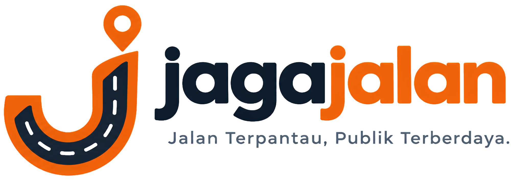

# JagaJalan

<p align="left">
  
</p>

### Know the Authority. Trace the Budget. Track the Action.

Platform Transparansi Jalan Publik Terintegrasi: Menghubungkan Status Kewenangan Geospasial, Penelusuran Paket Anggaran APBD/LPSE, dan Akselerasi Kepatuhan Pelayanan Publik.

Karya Inovasi Teknologi oleh **COMEL Team** untuk cabang kompetisi **Web In Action (WIA) - Multimedia In Action (MIA) 2026**, diselenggarakan oleh **KSM Multimedia UPN Veteran Jakarta**.

Tema Kompetisi: *Designing Digital Futures - Powering Public Transparency*

---

## 1. Latar Belakang dan Urgensi Masalah

Kerusakan jalan raya di Indonesia bukan sekadar persoalan teknis keausan aspal, melainkan cerminan tantangan transparansi tata kelola birokrasi, fragmentasi batas kewenangan, dan lemahnya keterbukaan penelusuran anggaran pemeliharaan. Berdasarkan data resmi nasional:

1. **Persoalan Tata Kelola Pelayanan Publik di Tingkat Daerah (Data Ombudsman RI 2025/2026)**
   Laporan Tahunan Ombudsman Republik Indonesia (dipublikasikan Februari 2026) mencatat bahwa sepanjang tahun 2025, sebanyak **4.766 laporan masyarakat tertuju kepada Pemerintah Daerah** (Pemerintah Provinsi, Kabupaten, dan Kota). Dari total laporan nasional, substansi perhubungan dan infrastruktur menyumbang **622 laporan**, dengan bentuk dugaan maladministrasi tertinggi adalah **Penundaan Berlarut (*Undue Delay*) sebesar 21,25%**. Data ini menegaskan adanya kendala substantif pada kecepatan tanggapan dan akuntabilitas birokrasi pelayanan publik di tingkat daerah.

2. **Disparitas Kemantapan Jalan Nasional vs Jalan Daerah**
   Berdasarkan basis data Satu Data Kementerian Pekerjaan Umum, terdapat kesenjangan kemantapan infrastruktur yang signifikan antara jalan nasional dan jalan daerah:
   - Jalan Nasional secara konsisten mencatat tingkat kemantapan di atas 90%.
   - Sebaliknya, jalan provinsi serta jalan kabupaten/kota di berbagai wilayah memiliki proporsi jalan rusak ringan hingga rusak berat yang tinggi akibat keterbatasan kapasitas fiskal dan alokasi anggaran pemeliharaan rutin daerah.
   - Kondisi disparitas ini menjadi latar belakang diterbitkannya **Instruksi Presiden (Inpres) No. 3 Tahun 2023 tentang Percepatan Peningkatan Konektivitas Jalan Daerah** dengan alokasi tahap pertama sebesar **Rp 14,6 Triliun pada Tahun Anggaran 2023** untuk mengintervensi perbaikan jalan daerah yang rusak.

3. **Fenomena "Saling Lempar Kewenangan" (*Blame-Shifting*)**
   Masyarakat awam kesulitan membedakan status administrasi jalan yang dilalui setiap hari:
   - Jalan Nasional: wewenang Kementerian Pekerjaan Umum melalui Balai Besar Pelaksanaan Jalan Nasional (BBPJN).
   - Jalan Provinsi: wewenang Dinas Bina Marga Provinsi.
   - Jalan Kota/Kabupaten: wewenang Dinas Pekerjaan Umum dan Penataan Ruang (PUPR) Daerah.
   Ketiadaan integrasi data spasial terbuka menyebabkan dinas pemerintah kerap melempar tanggung jawab (*blame-shifting*) atau menyatakan bahwa ruas yang dikeluhkan warga bukan merupakan wewenang instansinya.

4. **Ketiadaan Tautan Antara Titik Kerusakan dan Dokumen Tender Proyek APBD**
   Selama ini, sistem penanganan jalan dan sistem keterbukaan anggaran pengadaan (LPSE/APBD) berjalan di ruang terpisah (*siloed systems*). Masyarakat tidak memiliki akses untuk mengetahui apakah ruas jalan yang rusak telah memiliki alokasi anggaran paket pemeliharaan berkala, siapa kontraktor yang memenangkan tender, berapa nilai kontraknya, atau mengapa pengerjaan fisiknya belum terealisasi di lapangan.

5. **Justifikasi Pemilihan Wilayah Pilot (Jawa Barat & Koridor Bodetabek)**
   Provinsi Jawa Barat dan koridor aglomerasi Bodetabek (Bogor, Depok, Bekasi) dipilih sebagai wilayah percontohan (*pilot study*) berbasis pertimbangan data yang dapat diuji (*evidence-based justification*):
   - Ketersediaan portal keterbukaan data anggaran dan LPSE yang matang melalui Portal Satu Data Jabar dan LPSE Jabar.
   - Kelengkapan dokumen hukum penetapan status ruas jalan (Keputusan Menteri PU dan Keputusan Gubernur Jawa Barat).
   - Kepadatan mobilitas komuter harian dengan beban tonase beragam, di mana jalan nasional, provinsi, dan kota saling bersinggungan secara langsung.
   - Memungkinkan tim pengembang memverifikasi kebenaran ruas dan dokumen anggarannya secara akurat.

---

## 2. Posisi Inovasi dan Pembeda Utama (Diferensiasi)

JagaJalan **bukan sekadar aplikasi pelaporan jalan rusak konvensional**. Pemerintah telah memiliki sistem seperti **Jalan Kita 2.0** (Kementerian PU) dan **SP4N-LAPOR!** (Kementerian PANRB). Kehadiran JagaJalan diposisikan sebagai **Lapisan Transparansi Terpadu (*Integrated Transparency Layer*)** yang menghubungkan tiga informasi krusial yang selama ini terpisah:

### Tabel Perbandingan Sistem:

| Indikator Perbandingan | Jalan Kita 2.0 (Kementerian PU) | SP4N-LAPOR! (Nasional) | JagaJalan (COMEL Team) |
| :--- | :--- | :--- | :--- |
| **Cakupan Kewenangan** | Terbatas pada Jalan Nasional | Kanal aduan tekstual umum instansi | Lintas Status Terpadu (Nasional, Provinsi, Kota/Kabupaten) dalam 1 Peta Geospasial |
| **Dasar Hukum Ruas** | Tidak menampilkan dokumen SK ruas | Tidak menampilkan dasar hukum | Menampilkan Nomor SK Menteri / Gubernur / Walikota untuk setiap segmen |
| **Penelusuran Anggaran APBD** | Tidak ada data anggaran proyek | Tidak ada keterkaitan anggaran | Terhubung langsung dengan Data Paket Pengadaan LPSE, Pagu, Nilai Kontrak, & Tingkat Keyakinan (*Match Confidence*) |
| **Jejak Tindak Lanjut Publik** | Tertutup untuk penanganan internal | Terbatas pada pesan balasan teks | Riwayat tahapan terbuka: Verifikasi, Penerusan Instansi, Batas Waktu Tanggapan, & Dokumentasi Fisik |
| **Mekanisme Akuntabilitas** | Tidak ada integrasi eskalasi formal | Menunggu alur birokrasi standar | Pemantauan Tanggapan (14 Hari Kerja) & Generator Draf Formal Laporan ke Ombudsman RI |
| **Peran Utama Sistem** | Kanal pelaporan jalan nasional | Kanal aspirasi pengaduan umum | Lapisan Transparansi Geospasial, Anggaran, & Kepatuhan Pelayanan Publik |

---

## 3. Tiga Pilar Inti Identitas JagaJalan

### 1. Kewenangan Lintas Status Jalan (*Know the Authority*)
Warga dan pemangku kepentingan dapat mengidentifikasi secara pasti siapa penyelenggara jalan yang bertanggung jawab atas suatu ruas:
- Mengunci instansi berwenang resmi (Kementerian PU / BBPJN, Dinas Bina Marga Provinsi, atau Dinas PUPR Kota/Kabupaten).
- Menampilkan dokumen regulasi resmi penetapan ruas jalan (Surat Keputusan Menteri PUPR atau Keputusan Kepala Daerah).
- Menghilangkan kebiasaan saling lempar tanggung jawab birokrasi di hadapan publik.

### 2. Anggaran dan Proyek yang Dapat Ditelusuri (*Trace the Budget*)
Setiap segmen ruas jalan disandingkan dengan informasi paket pengadaan pemeliharaan jalan berkala:
- Nama paket pekerjaan pengadaan dan tahun anggaran berjalan.
- Nilai pagu anggaran dan nilai kontrak hasil lelang tender LPSE.
- Identitas nama penyedia jasa / kontraktor pelaksana.
- Indikator tingkat keyakinan pencocokan data (*Match Confidence*: Terkonfirmasi, Pencocokan Parsial, Belum Ditemukan) beserta catatan verifikasinya.

### 3. Jejak Tindak Lanjut yang Transparan (*Track the Action*)
Masyarakat dapat memantau perjalanan laporan secara terbuka dan kronologis:
- Tanggal dan jam laporan diverifikasi.
- Instansi penerima disposisi laporan.
- Penghitungan batas waktu tanggapan (*Response SLA* 14 hari kerja).
- Dokumentasi foto bukti tindak lanjut fisik (*before-after documentation*) sebagai syarat penutupan tiket aduan.

---

## 4. Fitur Pendukung: AI Vision & Pemantauan SLA Ombudsman RI

### A. AI Vision Sebagai Pendukung Keputusan (Decision Support)
Modul Computer Vision cerdas berfungsi sebagai alat bantu estimasi prioritas (*decision support tool*), bukan pengukuran fisik pasti tingkat laboratorium tanpa kalibrasi alat:
- **Klasifikasi Kategori Kerusakan**: Mengidentifikasi tipe kerusakan aspal visual (Lubang/Pothole, Penurunan Permukaan/Subsidence, Retak Buaya/Alligator Cracking).
- **Deteksi Spam & Duplikasi**: Membantu dinas menyaring foto yang tidak relevan atau mendeteksi foto duplikat pada titik lokasi yang sama.
- **Rekomendasi Skor Bahaya (*Hazard Score* Skala 1-100)**: Dihitung berdasarkan kombinasi jenis kerusakan visual, estimasi dimensi terhadap lebar jalan, dan posisi kerusakan pada lajur lalu lintas kendaraan.

### B. Pemantauan Batas Waktu Tanggapan & Generator Draf Ombudsman RI
- **Penafsiran Hukum yang Akurat**: Berdasarkan UU No. 25 Tahun 2009 tentang Pelayanan Publik dan ketentuan tata kelola Ombudsman RI, masyarakat yang melayangkan pengaduan pelayanan publik berhak memperoleh kepastian tindak lanjut. Apabila pengaduan tidak memperoleh tanggapan resmi dalam kurun waktu **14 hari kerja**, masyarakat memiliki hak prosedural untuk mengajukan laporan dugaan maladministrasi penundaan berlarut (*undue delay*) kepada Ombudsman RI.
- **Generator Draf Resmi**: Apabila indikator pemantauan melewati 14 hari kerja tanpa tanggapan instansi (*status: Keterlambatan Tanggapan*), sistem menyediakan fitur 1-klik untuk men-generate draf surat formal laporan ke Ombudsman RI. Draf ini memuat nomor tiket, koordinat geotagged, analisis AI, riwayat paket anggaran, serta dasar hukum yang dapat diperiksa, diunduh, dan diajukan warga secara mandiri ke kanal resmi Ombudsman RI.

### C. Dashboard Komparatif Regional 38 Provinsi
Menyajikan visualisasi data makro agregat 38 provinsi di Indonesia (bersumber dari publikasi resmi BPS dan SP4N-LAPOR!) yang dilengkapi filter wilayah pulau guna memberikan konteks perbandingan kebijakan publik nasional.

---

## 5. Alur Perjalanan Pengguna (Multi-Role User Journey)

### 1. Peran Masyarakat / Pengguna Jalan
1. Mengakses peta interaktif untuk mengecek status jalan dan aduan aktif di rute aktivitas hariannya.
2. Memilih ruas untuk melihat instansi penanggung jawab resmi, dasar hukum SK, dan dokumen paket tender APBD terkait.
3. Mengunggah foto bukti kerusakan jalan yang diverifikasi otomatis oleh modul AI Vision.
4. Memperoleh kode tiket pelaporan untuk memantau kronologi tindak lanjut dan batas waktu tanggapan dinas.
5. Mengunduh draf resmi laporan ke Ombudsman RI jika instansi terlapor tidak memberikan tanggapan melampaui 14 hari kerja.

### 2. Peran Aparatur / Dinas Penyelenggara Jalan
1. Memantau antrean aduan yang telah terklasifikasi berdasarkan rekomendasi tingkat bahaya AI dan konfirmasi warga.
2. Menghindari aduan salah sasaran karena batas yurisdiksi jalan telah terkunci oleh data geospasial resmi.
3. Memperbarui status penanganan fisik secara transparan (Menunggu Verifikasi, Dalam Penanganan Fisik, Selesai).
4. Mengunggah foto dokumentasi perbaikan sebagai bukti pertanggungjawaban publik.

---

## 6. Desain Sistem, Identitas Visual, dan Pemisahan Warna

### A. Identitas Visual dan Filosofi Logo
Logo resmi JagaJalan tersimpan dalam direktori `public/logo/` dan dirancang khusus dalam 3 format aset:
1. **`logo.png` (Simbol Ikon Utama)**:
   - **Siluet Jalan Beraspal ('J')**: Bentuk dasar huruf 'J' yang distilisasi menyerupai penampang lajur jalan raya beraspal, dilengkapi marka garis putih putus-putus (*road lane marking*) sebagai representasi fokus domain infrastruktur jalan.
   - **Pin Koordinat Geospasial**: Ornamen penanda lokasi di ujung atas huruf 'J' menyimbolkan presisi data geospasial (*geotagged accuracy*) dan penentuan batas kewenangan administratif per ruas jalan.
   - **Garis Luar Safety Orange**: Membingkai lambang dengan warna standar keselamatan kerja jalan raya untuk menegaskan proteksi, kewaspadaan, dan transparansi publik.
2. **`logo-name.png` (Tipografi Logotype)**:
   - Tipografi modern dan kokoh bertuliskan "JagaJalan" yang mengedepankan keterbacaan (*legibility*), kredibilitas institusional, dan ketegasan integritas publik.
3. **`full-logo.png` (Kombinasi Penuh Simbol & Logotype)**:
   - Komposisi lockup resmi yang memadukan simbol ikon 'J' dan nama JagaJalan secara seimbang untuk keperluan publikasi resmi, header dokumen, dan presentasi.

### B. Sistem Warna Status Kewenangan Jalan
Untuk menghindari bias interpretasi data, JagaJalan memisahkan secara tegas antara sistem warna status kewenangan jalan dengan sistem warna status laporan pengaduan:
- **Biru (`#2563eb`)**: Jalan Nasional (Kementerian Pekerjaan Umum / BBPJN).
- **Ungu (`#7c3aed`)**: Jalan Provinsi (Dinas Bina Marga Provinsi).
- **Teal (`#0d9488`)**: Jalan Kota / Kabupaten (Dinas PUPR Daerah).

### C. Sistem Warna Status Pengaduan & Tindak Lanjut
- **Merah (`#dc2626`)**: Terlambat Menanggapi (>14 hari kerja tanpa tanggapan instansi).
- **Amber (`#d97706`)**: Menunggu Verifikasi atau Sedang Dalam Penanganan.
- **Hijau (`#16a34a`)**: Penanganan Fisik Selesai Diperbaiki.

### D. Warna Brand Utama & Tombol Aksi
- **Safety Orange (`#ea580c` / `#f97316`)**: Standar keselamatan jalan raya internasional yang digunakan untuk logo, tombol aksi utama (*+ Lapor Kerusakan*), dan highlight interaktif.

---

## 7. Desain Skema Basis Data (Database Schema)

Model data dirancang dengan normalisasi relasional yang memisahkan relasi paket pengadaan dengan ruas jalan melalui tabel penghubung (*junction table*), menyertakan metadata asal-usul data (*provenance*), serta memisahkan status pengerjaan fisik dari indikator keterlambatan tanggapan:

```
+-----------------------------------------------------------------------------------+
|                        DATABASE SCHEMA - JAGAJALAN PLATFORM                       |
+-----------------------------------------------------------------------------------+

 1. provinces_stat
    - id (PK)
    - nama_provinsi
    - kode_kemendagri
    - panjang_jalan_rusak_km
    - persentase_rusak
    - total_aduan_tercatat
    - aduan_overdue_tanggapan_count
    - alokasi_inpres_miliar_rp
    - data_year

 2. road_segments
    - id (PK)
    - nama_ruas
    - kode_ruas
    - kewenangan (NASIONAL | PROVINSI | KOTA_KAB)
    - instansi_penanggungjawab
    - dasar_hukum_sk
    - panjang_km
    - tipe_perkerasan
    - status_kondisi
    - geometry_coordinates (GeoJSON Polyline)
    - wilayah_administrasi
    - source_document_sk

 3. budget_packages
    - id (PK)
    - kode_paket_lpse
    - nama_paket_pekerjaan
    - tahun_anggaran
    - pagu_anggaran_rp
    - nilai_kontrak_rp
    - nama_kontraktor
    - sumber_dana (APBD_KOTA | APBD_PROV | APBN | INPRES)
    - status_tender
    - source_url
    - source_document
    - last_verified_at

 4. budget_package_segments (Tabel Penghubung Multi-Ruas)
    - id (PK)
    - budget_package_id (FK -> budget_packages.id)
    - road_segment_id (FK -> road_segments.id)
    - match_confidence (TERKONFIRMASI | PARSIAL | BELUM_DITEMUKAN)
    - match_reason_note

 5. road_reports
    - id (PK)
    - ticket_code (Contoh: JGJ-DPK-081)
    - road_segment_id (FK -> road_segments.id)
    - latitude
    - longitude
    - alamat_patokan
    - foto_bukti_url
    - ai_damage_category (Pothole | Subsidence | Alligator_Cracking)
    - ai_hazard_score (1-100)
    - ai_analysis_summary
    - reporter_masked_name (Privasi: Contoh 'D*** A.')
    - tanggal_lapor
    - target_response_deadline (Tanggal lapor + 14 hari kerja)
    - status_penanganan (MENUNGGU_VERIFIKASI | DALAM_PENGERJAAN | SELESAI)
    - is_response_overdue (Boolean: true jika >14 hari tanpa tanggapan)
    - days_overdue
    - support_upvotes_count

 6. report_updates (Audit Trail Penanganan)
    - id (PK)
    - report_id (FK -> road_reports.id)
    - tahapan (DIVERIFIKASI | DITERUSKAN_KE_DINAS | DALAM_PENGERJAAN | SELESAI)
    - catatan_tindakan
    - instansi_pelaksana
    - foto_bukti_penanganan_url
    - updated_at

 7. ombudsman_escalations
    - id (PK)
    - report_id (FK -> road_reports.id)
    - nomor_surat_draf
    - ringkasan_dugaan_maladministrasi
    - status_diserahkan (DRAF | DIUNDUH_WARGA | TERKIRIM)
    - created_at
```

---

## 8. Arsitektur Komponen dan Alur Interaksi Sistem

```
+-----------------------------------------------------------------------------------+
|                        ARSITEKTUR KOMPONEN APLIKASI                               |
+-----------------------------------------------------------------------------------+

                    [ Pengguna: Warga / Publik ]
                                 │
                                 ▼
             +─────────────────────────────────────────+
             |         Next.js App Router (UI)         |
             |   Navbar • KPI Header • Papan 38 Prov   |
             +────────────────────┬────────────────────+
                                  │
         ┌────────────────────────┴────────────────────────┐
         ▼                                                 ▼
+───────────────────────────+             +───────────────────────────────────+
+   Interactive Map Engine  |             |      Smart AI Report Module       |
|  - React-Leaflet Viewport |             |  - Geotagging & Ruas Matching     |
|  - OpenStreetMap Tiles    |             |  - Computer Vision Classification |
|  - Dual Color Palette     |             |  - Decision Support Hazard Score  |
+─────────────┬─────────────+             +─────────────────┬─────────────────+
              │                                             │
              ▼                                             ▼
+───────────────────────────+             +───────────────────────────────────+
|     Inspector Drawer      |             |     SLA & Compliance Tracker      |
|  - Kunci Wewenang Instansi|             |  - Monitor Batas Waktu 14 Hari    |
|  - Paket LPSE & Confidence|             |  - Deteksi Overdue Tanggapan      |
|  - Jejak Status Pengerjaan|             |  - 1-Click Ombudsman RI Generator |
+───────────────────────────+             +───────────────────────────────────+
```

---

## 9. Struktur Organisasi Berkas Proyek

```text
jagajalan/
├── src/
│   ├── app/                     # Next.js App Router (Halaman & Desain Global)
│   │   ├── globals.css          # Desain sistem & token tema Clean Light Dashboard
│   │   ├── layout.js            # Metadata root & pembungkus font interaktif
│   │   └── page.js              # Halaman utama orkestrator tab navigasi
│   ├── components/              # Komponen Antarmuka Terstruktur
│   │   ├── layout/              # 1. Kerangka Tata Letak Global (Navbar, Footer)
│   │   │   ├── Navbar.jsx       # Header navigasi bersegmen & tombol lapor
│   │   │   └── Footer.jsx       # Navigasi penutup & atribusi data resmi
│   │   ├── dashboard/           # 2. Ringkasan Analitik & Metrik Eksekutif
│   │   │   ├── HeroSection.jsx  # Metrik ringkasan & diferensiasi 3 pilar utama
│   │   │   └── NationalRankingSection.jsx # Papan skor perbandingan makro 38 provinsi
│   │   ├── map/                 # 3. Mesin Pemetaan Geospasial
│   │   │   ├── MapExplorer.jsx  # Workspace peta & panel rincian APBD/Wewenang
│   │   │   └── MapInner.jsx     # Layer OpenStreetMap, polyline ruas & custom pins
│   │   ├── modals/              # 4. Dialog Interaktif & Eskalasi Hukum
│   │   │   ├── ReportModal.jsx  # Formulir geotag aduan & verifikasi AI Vision
│   │   │   └── OmbudsmanModal.jsx # Generator draf laporan formal ke Ombudsman RI
│   │   └── index.js             # Sentralisasi barrel export komponen
│   ├── data/                    # Sumber Basis Data & Agregasi Resmi
│   │   ├── provincesData.js     # Data makro 38 provinsi (BPS & SP4N-LAPOR!)
│   │   ├── roadsData.js         # Ruas jalan pilot, SK wewenang & paket LPSE
│   │   └── reportsData.js       # Rekam aduan geotagged warga & status SLA
│   └── lib/                     # Modul Utilitas & Standar Global
│       ├── constants.js         # Kodefikasi warna (Biru/Ungu/Teal) & limit SLA
│       └── utils.js             # Format mata uang Rupiah, kalkulasi SLA, & skor AI
├── public/                      # Aset statis & identitas visual
│   └── logo/                    # Varian logo resmi JagaJalan
│       ├── logo.png             # Simbol ikon utama (siluet 'J' jalan raya & pin)
│       ├── logo-name.png        # Tipografi resmi nama "JagaJalan"
│       └── full-logo.png        # Kombinasi penuh simbol ikon & logotype
├── .gitignore                   # Proteksi dependensi, node_modules, cache, & env
├── LICENSE                      # Lisensi resmi MIT License
├── package.json                 # Konfigurasi dependensi Next.js 16 & Tailwind v4
└── README.md                    # Dokumen konsep, skema database, & arsitektur sistem
```

---

## 10. Spesifikasi Tumpukan Teknologi (Tech Stack)

- **Frontend Framework**: Next.js 16 (App Router Architecture, React 19)
- **Styling Engine**: Tailwind CSS v4 (Sistem Desain Slate Terang & Safety Orange)
- **Geospatial Engine**: Leaflet.js dan React-Leaflet
- **Map Tile Provider**: OpenStreetMap Standard Light Layer (Lisensi Terbuka, Tanpa Watermark)
- **AI Analytics Module**: Computer Vision Decision Support
- **Iconography**: Lucide React
- **Build Engine**: Next.js Turbopack

---

## 11. Sumber Data Resmi dan Dasar Regulasi Hukum

1. **Laporan Tahunan Ombudsman Republik Indonesia (2025/2026)**: Statistik pengaduan maladministrasi instansi pemerintah daerah, substansi perhubungan/infrastruktur, dan prevalensi penundaan berlarut (*undue delay*).
2. **Satu Data Kementerian Pekerjaan Umum**: Basis data panjang jalan, tingkat kemantapan jalan nasional, dan data penanganan Inpres Jalan Daerah (IJD).
3. **Badan Pusat Statistik (BPS)**: Statistik Transportasi Darat Indonesia dan agregat kemantapan jalan provinsi.
4. **Portal Satu Data Jawa Barat & LPSE Jabar**: Data pengadaan paket tender pemeliharaan berkala jalan APBD/LPSE dan realisasi fisik.
5. **Keputusan Menteri PUPR & Keputusan Kepala Daerah**: Dokumen penetapan status dan nomor kode ruas jalan.
6. **Undang-Undang No. 25 Tahun 2009 tentang Pelayanan Publik**: Dasar penentuan batas waktu tanggapan pelayanan publik (Response SLA 14 hari kerja).
7. **Undang-Undang No. 37 Tahun 2008 tentang Ombudsman Republik Indonesia**: Landasan hak hukum masyarakat untuk melaporkan dugaan maladministrasi penundaan berlarut (*undue delay*).

---

## 12. Identitas Pengembang

- **Nama Tim**: COMEL Team
- **Kompetisi**: Multimedia In Action (MIA) 2026 - Web In Action (WIA)
- **Penyelenggara**: KSM Multimedia UPN Veteran Jakarta
- **Tahun**: 2026

---

## 13. Lisensi (License)

Seluruh kode sumber, basis data sampel, dan spesifikasi arsitektur proyek JagaJalan didistribusikan secara terbuka di bawah naungan **MIT License**.

Hak Cipta (c) 2026 COMEL Team - Cabang Lomba Web In Action (WIA), Multimedia In Action (MIA) 2026, KSM Multimedia UPN Veteran Jakarta.

Teks lengkap ketentuan lisensi dapat diakses secara langsung pada berkas [LICENSE](file:///d:/Lomba/MIA/COMEL%20Team/Projects/jagajalan/LICENSE).
